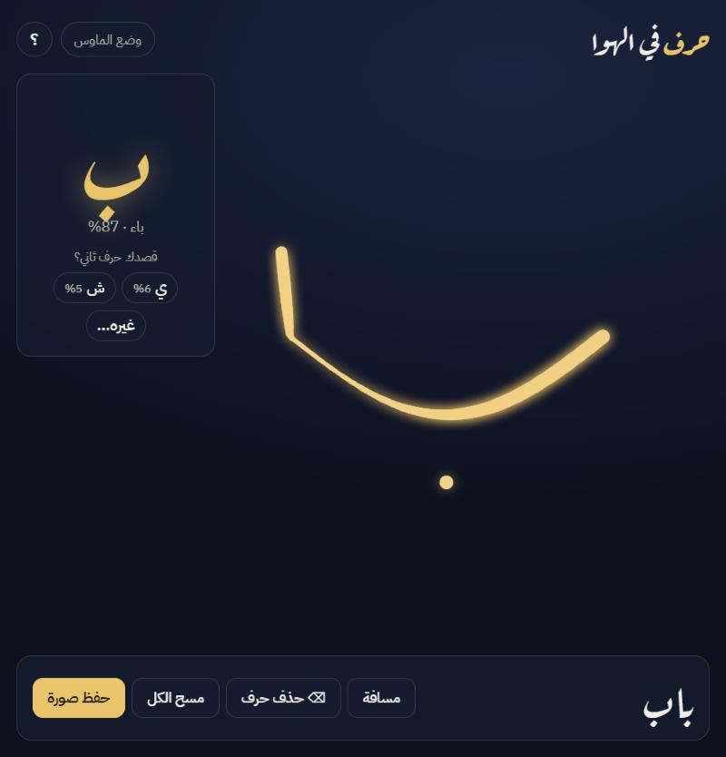

# حرف في الهوا ✍️ | Harf fil Hawa

**اكتب حروف عربية في الهوا بإصبعك قدام الكاميرا. الموقع يرسمها بخط ذهبي على شكل خط القلم، ويتعرّف على كل حرف، ويجمع الحروف لين تصير كلمة.**

**Write Arabic letters in the air with your finger in front of a webcam. The page draws them with a calligraphy-style brush, recognizes each letter, and builds them into words.**

### [▶ جرّبها مباشرة | Try it live](https://marwathebest.github.io/harf-fil-hawa/)



## طريقة الاستخدام | How to use

1. اضغط **شغّل الكاميرا**، أو **جرّب بالماوس** لو ما عندك كاميرا.
2. **قرّب السبابة من الإبهام** عشان يبدأ الرسم، و**بعّدهم** عشان يوقف.
3. اكتب الحرف بشكله المنفصل. النقاط تكون بنقرة سريعة.
4. وقّف ثانية، فيطلع الحرف وينضاف للكلمة. لو قرأه غلط، اختر الحرف الصح والموقع **يتعلّم خطك**.
5. **حفظ صورة** يطلّع لك الكلمة كبوستر PNG.

## كيف يشتغل | How it works

| الجزء | Part | |
|---|---|---|
| تتبّع اليد | Hand tracking | [MediaPipe Hand Landmarker](https://developers.google.com/mediapipe/solutions/vision/hand_landmarker) داخل المتصفح (WebAssembly + GPU). يمر على ٢١ نقطة في اليد مع كل فريم |
| بدء الرسم | Pinch | المسافة بين طرف الإبهام وطرف السبابة، مقسومة على حجم اليد. وفيه هامش بين بداية الرسم ونهايته عشان ما يرتجف |
| تنعيم الحركة | Smoothing | [One Euro Filter](https://gery.casiez.net/1euro/) يشيل رجفة اليد، ويخلي الحركة السريعة سريعة |
| الفرشاة | Brush | قلم مسطّح بزاوية ٣٥°، يعرض ويرفع حسب اتجاه الحركة زي قلم الخط العربي |
| التعرّف | Recognition | بدون تدريب: كل حرف من الـ ٢٨ ينرسم بخمسة خطوط عربية، وبعدين الكتابة والحروف يتحوّلون لهيكل بعرض بكسل واحد (Zhang-Suen thinning). المقارنة بمسافة chamfer، مع عدد أجزاء الحرف ونقاطه ونسبة طوله لعرضه |
| التعلّم | Learning | لما تصحّح حرف، تنحفظ كتابتك كقالب جديد في المتصفح (localStorage) |

**الدقة | Accuracy:** على خطوط ما تعلّم منها المتعرّف، تطلع الدقة **٩٠٪** للحرف الأول، و**٨٤٪** لو أضفنا الخط الكوفي اللي شكله بعيد عن خط اليد. تقدر تعيد الاختبار من [`tools/accuracy.html`](tools/accuracy.html). أما خط اليد الحقيقي فيختلف من شخص لشخص، وعشان كذا أضفت ميزة التعلّم من التصحيح.

**الخصوصية | Privacy:** كل المعالجة تصير داخل المتصفح، وما ينرسل أي فيديو أو صورة لأي سيرفر.

## التشغيل محلياً | Run locally

```bash
python -m http.server 8000
```

وبعدها افتح `http://localhost:8000`. الكاميرا ما تشتغل إلا على `localhost` أو `https`.

## الملفات | Files

| | |
|---|---|
| `index.html` · `css/style.css` | الواجهة (RTL) |
| `js/app.js` | الكاميرا، تتبّع اليد، الرسم، والتعلّم من التصحيح |
| `js/recognizer.js` | التعرّف على الحرف |
| `tools/accuracy.html` | اختبار الدقة على خطوط ما تعلّم منها المتعرّف |

## التقنيات | Tech

JavaScript (ES modules) · Canvas 2D · MediaPipe Tasks Vision · Computer vision (thinning, distance transform, chamfer matching) · بدون أي framework أو build step

---

Made by [Marwah Abdullah Sabei](https://github.com/marwathebest)
